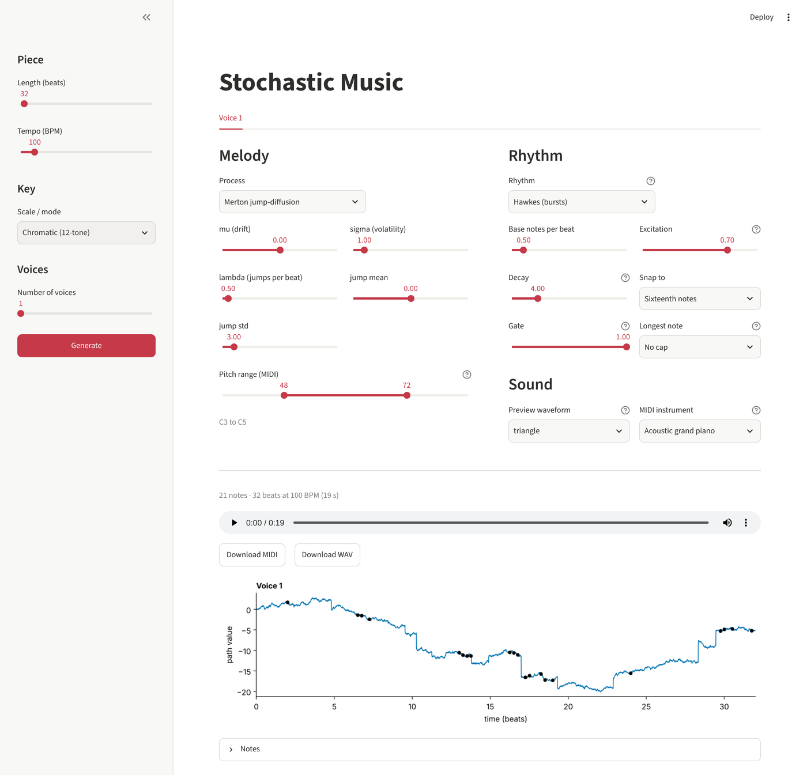

# Stochastic Music

A Python project that turns stochastic processes into music. Pick a process, tune its parameters, and listen to its random path played as a melody.



## 🎵 How it works

Every piece goes through the same four steps:

- a stochastic process is simulated (a random walk, a mean-reverting process, a process with jumps...)
- a clock decides when the notes start, which gives the rhythm
- the path is read at each of those moments
- each value is turned into a note, inside the pitch range and scale you chose

The path is stretched to fill the pitch range you chose. So what you hear is the shape of the path, not its size: a parameter that only shifts or rescales the path changes nothing in the sound, and the app hides those parameters.

Every piece is unique. Nothing is seeded, so the same piece can never come out twice. Download it if you like it!

## 📦 Required Libraries

- **numpy** - Simulations and numerical computing
- **mido** - Writing the MIDI files
- **streamlit** - The web app
- **matplotlib** - Plotting the paths

### Installation

Open a terminal in the project folder (in VS Code: Terminal > New Terminal) and run:

```bash
py -m pip install -e ".[app]"        # Windows
python3 -m pip install -e ".[app]"   # macOS / Linux
```

This installs the project and everything it needs. You only have to do it once.

## 🚀 How to Run

From the project folder:

```bash
py -m streamlit run src/stochastic_music/app.py        # Windows
python3 -m streamlit run src/stochastic_music/app.py   # macOS / Linux
```

On Windows you can also just double-click `run_app.bat`.

The app opens in your browser. Then:

- set the length, tempo, key and number of voices in the sidebar
- choose a process and a rhythm for each voice in its tab
- press **Generate** and listen!
- download the result as a MIDI file (to open in a DAW) or a WAV file

To stop the app, press `Ctrl+C` in the terminal.

## 🎛️ Processes

| Process | What you'll hear |
|---|---|
| Wiener process | A free random walk |
| Brownian motion | A random walk with a trend up or down |
| Fractional Brownian motion | A random walk with memory: long phrases (H > 0.5) or zigzags (H < 0.5) |
| Brownian bridge | A random walk that comes back to where it started |
| Geometric Brownian motion | Moves more when high, less when low |
| Ornstein-Uhlenbeck | Keeps getting pulled back to a central note |
| CIR | Pulled back to a central note, and gets quiet near the bottom of its range |
| Heston | Calm passages alternating with busy ones (optional rough volatility) |
| SABR | Like Heston, but the agitation drifts and never settles |
| Merton jump-diffusion | A random walk with sudden big leaps |
| Variance Gamma | Mostly small moves, with the odd very large one |

## 🥁 Rhythm

- **Fixed grid** - One note per step (half, quarter, eighth or sixteenth notes)
- **Poisson** - Rhythm follows a Poisson process
- **Hawkes** - Rhythm follows a Hawkes process: notes come in bursts
- **Driven by a process** - Another stochastic process dictates note lengths

With several voices, you can also correlate them: positive correlation makes the voices move together, negative makes them move in contrary motion.

## 🐍 Using it from Python

You don't need the app. A few lines are enough:

```python
import stochastic_music as sm

piece = sm.compose(sm.MertonJumpDiffusion(), length=32, bpm=110)
piece.write_midi("melody.mid")
piece.write_wav("melody.wav")
```

More examples (several voices, scales, rhythms) are in `examples/quickstart.py`.

## 📁 Project Structure

- `src/stochastic_music/` - The code
  - `paths.py` - The stochastic processes
  - `clock.py` - The rhythms
  - `pitch_mapping.py` - From path values to notes, scales and modes
  - `midi_writer.py` - MIDI export
  - `synth.py` - The small synthesizer used for the audio preview
  - `pipeline.py` - Puts all the steps together
  - `catalog.py` - Parameter ranges shown in the app
  - `app.py` - The web app
- `tests/` - Automated tests
- `examples/` - Example script
- `run_app.bat` - Starts the app on Windows

## ⚠️ Limitations

- Paths are stretched to fit the pitch range, so only the shape of a process can be heard, not its scale.
- Parameter ranges are limited to values that give usable music.
- The audio preview uses a basic built-in synthesizer. For a real sound, open the MIDI file in a DAW.
- Music has its own rules (harmony, structure, repetition) that a random process knows nothing about. The results are random tunes, not compositions.

## 🧪 Tests

```bash
py -m pip install -e ".[dev]"
py -m pytest
```

## 📄 License

MIT, see [LICENSE](LICENSE).
