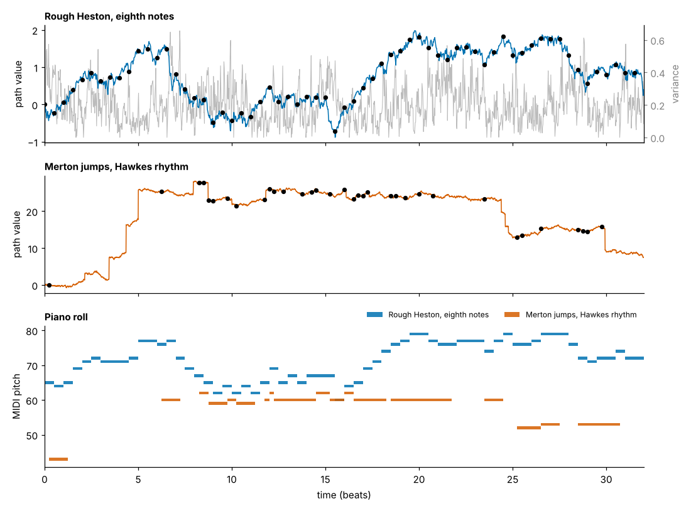

# Stochastic Music

[](https://github.com/f-x-cst/stochastic-music/actions/workflows/ci.yml)


Simulate a stochastic process and hear its path as a melody. One path, one voice.

The models are the ones used in quantitative finance (Brownian motion, mean reversion,
stochastic and rough volatility, jumps). Each one has a recognisable musical character:
a mean-reverting process hovers around a tonal centre, a jump process breaks stepwise
motion with sudden leaps, and stochastic volatility alternates calm passages with busy
ones.



## Features

- **9 processes**: Wiener, Brownian motion with drift, geometric Brownian motion,
  Ornstein-Uhlenbeck, CIR, Heston (standard or rough volatility), SABR, Merton
  jump-diffusion and Variance Gamma.
- **Several voices at once**, each with its own process, correlated through their
  driving shocks: voices that move together, or in contrary motion.
- **Stochastic rhythm**: a fixed grid, Poisson arrivals, a self-exciting Hawkes process
  (bursts and silences), or a second stochastic process that sets the note lengths.
- **14 scales and modes** with any root note.
- **Output** as a multi-track MIDI file for a DAW, or a WAV preview rendered with a
  small built-in synthesizer (no external sound font needed).
- **A web app** to explore everything with sliders, listen, and download the result.

## Installation

```bash
git clone https://github.com/f-x-cst/stochastic-music.git
cd stochastic-music
pip install -e ".[app]"
```

`pip install -e .` installs the library alone (it only needs numpy and mido).
The `[app]` extra adds Streamlit and matplotlib.

## The web app

```bash
stochastic-music
```

This opens the app in your browser. Choose the length, tempo, key and number of voices
in the sidebar. Then set each voice's process, pitch range and rhythm in its tab, and
press **Generate**. You get an audio player, a plot of the paths and a piano roll, and
the MIDI and WAV downloads.

## Using the library

```python
import stochastic_music as sm

piece = sm.compose(sm.OrnsteinUhlenbeckProcess(kappa=3.0), length=32, bpm=110, seed=7)
piece.write_midi("melody.mid")
piece.write_wav("melody.wav")
```

Every voice can be configured with a `VoiceSpec`:

```python
piece = sm.compose(
    [
        sm.VoiceSpec(
            sm.CIRProcess(kappa=1.0, xi=0.8),
            clock=sm.UniformClock(2.0),  # half notes
            mapper=sm.RealizedRangeBinner(36, 50, scale="Dorian", root="D"),
            name="Bass",
            program=32,  # General MIDI acoustic bass
        ),
        sm.VoiceSpec(
            sm.MertonJumpDiffusion(lambda_jump=0.8, jump_std=4.0),
            clock=sm.HawkesClock(base_rate=0.6, excitation=0.75, decay=6.0),
            mapper=sm.RealizedRangeBinner(62, 86, scale="Dorian", root="D"),
            name="Lead",
            max_note_beats=1.0,
            waveform="saw",
        ),
    ],
    length=64,
    bpm=120,
    seed=11,
    correlation=0.6,  # one number for every pair, or a full matrix
)
```

`examples/quickstart.py` writes three example pieces to `./outputs/`.
To draw a piece, use `stochastic_music.plotting.plot_piece(piece)`.

## How it works

Four independent layers, each replaceable without touching the others:

| Layer | Module | Responsibility |
|---|---|---|
| Paths | `paths.py` | Simulate the raw stochastic process |
| Clock | `clock.py` | Decide when notes start (the rhythm) |
| Pitch mapping | `pitch_mapping.py` | Turn path values into MIDI pitches |
| Output | `midi_writer.py`, `synth.py` | Write the MIDI file, render the audio preview |

`pipeline.compose` wires them together: simulate the paths, ask each voice's clock for
note onsets, read the path at those onsets, and map the values to pitches. Time is
measured in beats everywhere, so a mean-reversion speed of 2 means "per beat".

**Pitch mapping.** The values read from a path are stretched to fill the chosen pitch
range, then cut into equal bins, one per note of the scale. Every scale degree gets the
same share of the range, whatever the size of the interval to its neighbours.

**What you can hear.** Because each path is rescaled to its own range, a parameter that
only shifts the path (a starting value) or rescales it (the volatility of a pure Wiener
process) makes no audible difference. Only parameters that change the path's *shape*
matter, such as drift against noise, mean reversion, jumps and volatility clustering. The
app hides the parameters you cannot hear.

**Correlated voices.** Every process is written as a function of its main Brownian
shocks. For several voices, those shocks are drawn jointly with a Cholesky factor of the
correlation matrix, so voices of different models can still be correlated. Models with
randomness of their own (jumps, stochastic volatility, random clocks) end up less
correlated than their shocks.

### Processes

| Process | Dynamics | How it sounds |
|---|---|---|
| Wiener | dX = σ dW | A free random walk |
| Brownian motion | dX = μ dt + σ dW | A random walk that climbs or falls |
| Geometric Brownian motion | dS = μS dt + σS dW | Busier when high, calmer when low |
| Ornstein-Uhlenbeck | dX = κ(θ − X) dt + σ dW | Hovers around a tonal centre |
| CIR | dX = κ(θ − X) dt + ξ√X dW | Mean-reverting, goes quiet near its floor |
| Heston | dX = √v dW, v is CIR | Calm passages alternating with busy ones |
| Rough Heston | v driven by a fractional kernel, H < 0.5 | Burstier, more jagged energy |
| SABR | dF = σF^β dW, dσ = ασ dZ | Energy that drifts and never settles |
| Merton | Brownian motion + Poisson jumps | Stepwise motion broken by large leaps |
| Variance Gamma | Brownian motion on a Gamma clock | Mostly small moves, the odd very large one |

Heston, Merton and the CIR variance are written in additive form, so the path can move
freely in both directions. CIR, Heston variance and SABR use Euler-Maruyama with full
truncation at zero; Wiener, Brownian motion, GBM and Variance Gamma are simulated
exactly. The rough Heston variance uses a Volterra Euler scheme on a grid of at most
3,000 steps, since its cost grows with the square of the number of steps.

### Rhythm

| Clock | Behaviour |
|---|---|
| `UniformClock(step)` | One note every `step` beats |
| `PoissonClock(rate, grid)` | Notes at random times, with no memory |
| `HawkesClock(base_rate, excitation, decay, grid)` | Each note raises the chance of another: bursts and silences |
| `ProcessClock(process, durations)` | A second process sets the note lengths: high values give short notes |

Random onsets are snapped to a grid (sixteenth notes by default). The Hawkes process is
simulated exactly with Ogata's thinning algorithm.

## Development

```bash
pip install -e ".[dev]"
pytest
ruff check .
```

Continuous integration runs the linter and the tests on Python 3.10 to 3.13.

## License

[MIT](LICENSE)
